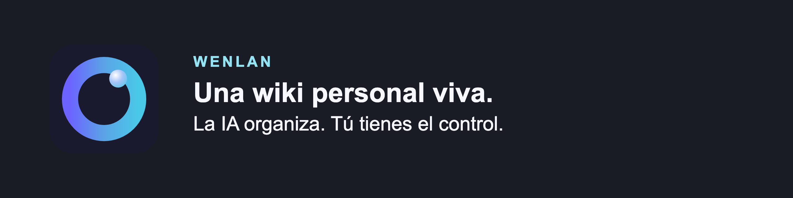
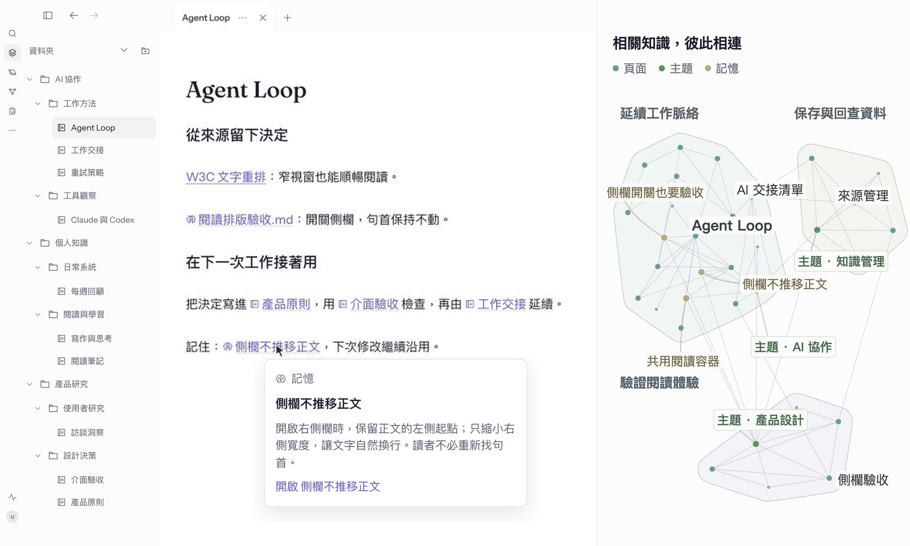
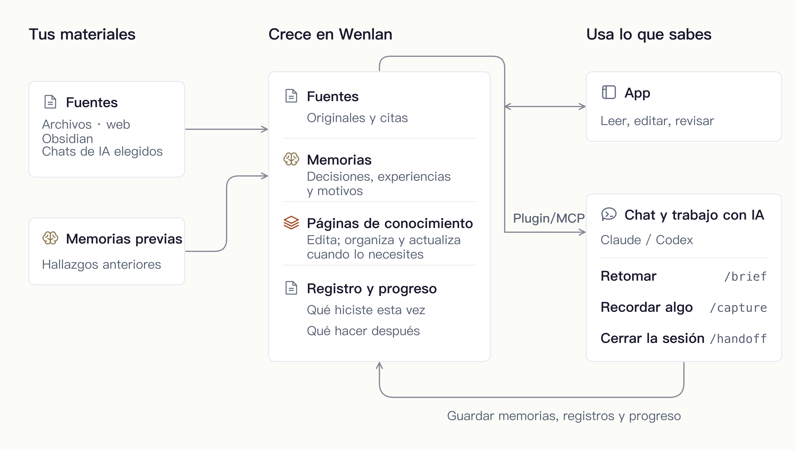
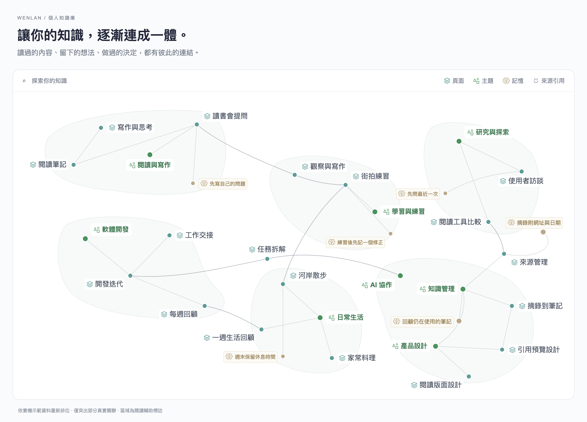
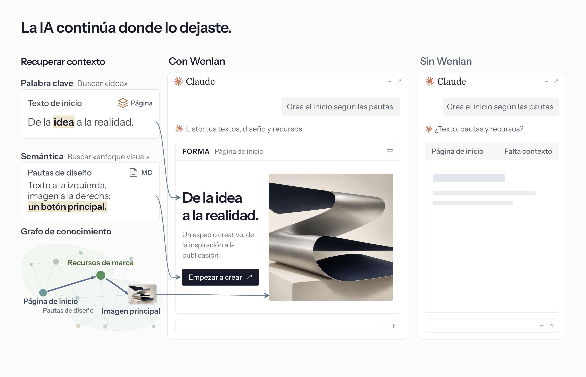

<!-- README_SYNC: source=README.md sha256=5a3a40ac100acd0a84691c2c8f904f25d5ee8fe6d024c40c0055aa2b0d7510e3 -->

  <picture>
    <source media="(max-width: 600px)" srcset="./docs/assets/readme-banner-es-ES-mobile.png">
    
  </picture>

  Wenlan organiza notas, documentos y conversaciones dispersos en una base de conocimiento que se actualiza y enlaza a sus fuentes, 
  para que tú y herramientas de IA como Claude y Codex reutilicéis lo aprendido sin tener que explicar de nuevo decisiones anteriores.

  <a href="./README.md">English</a> | <a href="./README.zh-Hans.md">简体中文</a> | <a href="./README.zh-Hant.md">繁體中文</a> | Español

  
  
  

  <a href="#start-in-30-seconds">Primeros&nbsp;pasos</a> ·
  <a href="#what-can-i-bring-in">Funciones</a> ·
  <a href="#learn-more">Docs</a> ·
  <a href="https://discord.gg/nmzVTTU3HG">Discord</a>

<!-- Replace the linked walkthrough when the separately produced release video is ready. -->

  
   <a href="https://github.com/user-attachments/assets/35f06749-00e5-484d-a9f4-5e462de8d11e">▶ Ver el vídeo</a>

Composición de vistas reales con datos de ejemplo; el grafo es ilustrativo, no una vista nativa de tres columnas.

## Primeros pasos

### 1. Descarga y abre Wenlan

[Descarga la aplicación de escritorio](https://github.com/wenlan-app/wenlan/releases/latest) y ábrela:

- **macOS (Apple Silicon):** abre el `.dmg` y arrastra Wenlan a Aplicaciones. La aplicación está firmada y notarizada.
- **Windows x64:** ejecuta el `-setup.exe`; todavía no está firmado. Si SmartScreen avisa, confirma que procede de la página oficial de Releases antes de elegir «Más información» → «Ejecutar de todas formas».
- **Linux:** aún no hay aplicación de escritorio; sigue la [guía de configuración de IA](docs/setup-with-ai.md#install-the-runtime) para instalar el runtime.

Al iniciar por primera vez se descarga el modelo de búsqueda local. Mantén la conexión hasta terminar la configuración. [Detalles de descarga y privacidad](docs/PRIVACY.md#when-wenlan-reaches-the-network).

También puedes [usar Wenlan sin la aplicación de escritorio](docs/setup-and-data.es-ES.md#installation) mediante herramientas de IA o la CLI, con la misma base de conocimiento local.

### 2. Abre un ejemplo o crea una página

Elige **Open notes** para entrar en Wenlan. Explora el ejemplo de bienvenida o crea una página propia.

### 3. Conecta una herramienta de IA cuando quieras

| Herramienta de IA | Conexión | Configuración |
|---|---|---|
| Claude Code | Plugin | [Guía de Claude Code](docs/setup-with-ai.md#claude-code) |
| Codex | Plugin | [Guía de Codex](docs/setup-with-ai.md#codex) |
| Cursor, Claude Desktop, VS Code, Gemini CLI | MCP | [Guía de MCP](docs/setup-with-ai.md#mcp-only-setup-and-other-clients) |

Tras instalar un plugin, inicia una nueva sesión de IA y ejecuta `/setup`. Conectar tu IA no requiere otro modelo de lenguaje local.

> Usa mis notas anteriores para ayudarme a terminar esta tarea.

**Primera prueba superada:** Tu IA encuentra la nota guardada o el documento importado que le pediste y cita una fuente que puedes comprobar.

## Uso diario

Puedes usar la aplicación por sí sola o trabajar con tu IA. Guarda en Wenlan el conocimiento útil y el progreso para retomarlos en la próxima tarea.

  

Flujo simplificado. Los comandos del plugin y la organización de páginas son opcionales, sin un orden fijo.

- **Empieza por tu material.** Escribe una página o importa documentos y conversaciones seleccionadas como fuentes. No necesitas conectar una IA.
- **Usa tu conocimiento y escribe páginas nuevas.** Pide a tu IA que use las fuentes y memorias guardadas para completar una tarea o escribir una página nueva con citas. En la aplicación puedes editar páginas, consultar las fuentes citadas y revisar cambios; usa `/recall` en tu herramienta de IA para recuperar contexto anterior.
- **Conserva lo que aprendes.** Guarda una decisión o lección, junto con sus motivos y fuentes, en la aplicación o con `/capture` a través de tu IA.
- **Pausa y retoma.** `/handoff` guarda memorias útiles y un registro de la sesión, y actualiza el Brief del Espacio actual con el progreso y los siguientes pasos. Usa `/brief` cuando quieras retomar ese contexto en la siguiente sesión.

**Cuando quieras una página de conocimiento:** `/distill` sintetiza o actualiza páginas con citas. También puedes escribirlas directamente o configurar la IA en segundo plano. [Comandos del plugin](plugin/skills/README.md).

## Organiza la información dispersa en conocimiento

Las **fuentes** conservan el material que has leído; las **memorias** recogen tus conclusiones y el razonamiento que las sustenta. Reúne ambas en **páginas Markdown con citas** que puedas leer, editar y enlazar mediante `[[wikilinks]]`. Sigue las citas para consultar el material original.

- **Importación de archivos y conversaciones:** Importa Markdown, texto, PDF con texto seleccionable, carpetas y ZIP de ChatGPT o Claude conservando las referencias a sus fuentes. Los PDF escaneados necesitan extracción de texto antes de importarlos. Los chats importados conservan una instantánea; las fuentes de archivos registradas se pueden actualizar desde el disco.
- **Conexión de solo lectura con Obsidian:** Lee una bóveda existente y actualízala bajo demanda sin modificar sus archivos ni sincronizar cambios de vuelta.
- **Memorias atómicas:** Guarda decisiones, lecciones y preferencias de una en una, con sus motivos y fuentes, desde la app o mediante tu IA.
- **Grafo de conocimiento:** Descubre temas relacionados mediante entidades tipadas, relaciones y grupos de conocimiento (comunidades); un modelo de enriquecimiento configurado vincula menciones repetidas a la misma entidad (resolución de menciones).

  

Nodos y conexiones de la app; los nombres y límites de las regiones son ilustrativos.

## Pon tu conocimiento a trabajar con IA

Usa la misma base de conocimiento con distintas herramientas de IA. Los **plugins** indican cuándo recuperar contexto anterior y guardar decisiones nuevas; las **conexiones solo por MCP** permiten que tu IA use estas herramientas cuando las necesite o se lo pidas.

- **[Búsqueda híbrida local](docs/technical-foundations.md#retrieval-pipeline):** Encuentra términos exactos y significados similares con SQLite FTS5 y embeddings BGE, combinados mediante Reciprocal Rank Fusion (RRF) ponderado; la búsqueda base no requiere clave API.
- **Clasificación asistida por el grafo:** Prioriza memorias relacionadas cuando hay enlaces entre entidades, con reranking cross-encoder opcional para afinar la relevancia.
- **Búsqueda por Espacio:** Selecciona un Espacio para limitar el conocimiento devuelto al proyecto o colección personal pertinente.

  

Ejemplo ficticio, no una prueba del producto; Wenlan aporta contexto junto con la memoria nativa de Claude.

El acceso web experimental permite que clientes compatibles busquen en toda la biblioteca o en un Espacio elegido, mientras el ordenador con Wenlan permanece conectado. Las consultas y los resultados pasan por un relay; consulta sus [límites de privacidad](docs/PRIVACY.md#pre-release-standalone-wenlan-relay-connector).

## Actualiza el conocimiento, conserva su historial

- **Enriquecimiento en segundo plano con Steep:** Añade tipos, datos estructurados, pistas de búsqueda y enlaces al grafo a las memorias capturadas; la síntesis opcional combina memorias y fuentes en páginas con citas.
- **[Revisión e historial](docs/knowledge-guide.es-ES.md#updates-and-history):** Compara versiones de páginas y sigue las sustituciones de memorias; la actualización automática modifica directamente las páginas mantenidas por la IA que cumplen los requisitos y propone revisiones para las que hayas editado.
- **Exportación de wikis:** Exporta las páginas aptas como una wiki Open Knowledge Format (OKF).
- **[Modelos opcionales en segundo plano](docs/setup-and-data.es-ES.md#models):** Activa el enriquecimiento, la síntesis y la actualización automática con Qwen en el dispositivo (llama.cpp), servidores locales compatibles con OpenAI como Ollama o LM Studio, o proveedores de nube configurados.

  

Vistas de la app con datos de ejemplo; conexiones y etiquetas ilustrativas.

## Arquitectura

**Una base local compartida.** La app, la CLI y las herramientas de IA conectadas leen y escriben mediante el servicio local de Wenlan. Las páginas son archivos Markdown; memorias, relaciones e índices de búsqueda residen en libSQL local.

**Las actualizaciones siguen las citas.** Si cambias o eliminas en Wenlan una fuente o memoria citada, el sistema marca para actualizar las páginas que la utilizan. Con la IA en segundo plano activada y un modelo disponible, las páginas aptas se reconstruyen a partir de las evidencias actuales; se rechazan los borradores con citas insuficientes.

  

Esquema de la arquitectura. [Búsqueda, evidencias y modelos](docs/technical-foundations.md).

## Datos y privacidad

Un cliente de IA en la nube puede enviarle el conocimiento recuperado a su proveedor; un modelo en la nube también recibe el contenido que procesa. El almacenamiento local no mantiene locales esas interacciones. Las estadísticas de uso están desactivadas por defecto.

[Ubicación de archivos, copias y eliminación](docs/setup-and-data.es-ES.md#backup-and-removal) · [Red y privacidad](docs/PRIVACY.md#when-wenlan-reaches-the-network).

## Evaluación

Estos resultados indican si la búsqueda encuentra conocimiento relacionado; no miden la calidad de las respuestas de IA.

<!-- EVAL_SNAPSHOT_START -->
| Benchmark | Recall@5 | MRR | NDCG@10 |
|---|---:|---:|---:|
| LME_Oracle (500 Q) | 93.6% | 0.857 | 0.883 |
| LME_S (deep, 90 Q) | 87.7% | 0.815 | 0.822 |
<!-- EVAL_SNAPSHOT_END -->

[Método de evaluación y detalles del benchmark](docs/eval/README.md).

## Leer más

- [Primeros pasos e instalación](docs/setup-and-data.es-ES.md#installation)
- [Conectar una herramienta de IA](docs/setup-with-ai.md)
- [Fuentes e importaciones](docs/knowledge-guide.es-ES.md#sources-and-pages) · [Archivos locales, copias y uso sin conexión](docs/setup-and-data.es-ES.md)
- [Privacidad](docs/PRIVACY.md)
- [Diagnóstico e incidencias](https://wenlan.app/docs/diagnostics-and-issue-reports)
- [Índice completo de documentación](docs/README.md)

## Contribuir

Únete a la [comunidad de Discord](https://discord.gg/nmzVTTU3HG). Informa de errores o pide funciones en [GitHub issues](https://github.com/wenlan-app/wenlan/issues); son públicos, así que oculta secretos y datos personales. Para contribuir con código o documentación, consulta [Contribuir](.github/CONTRIBUTING.md), [Seguridad](.github/SECURITY.md) y el [Código de Conducta](.github/CODE_OF_CONDUCT.md).

## Política de firma de código

Consulta los [detalles de firma y notarización por plataforma](docs/code-signing.md).

## Licencia

El runtime local, la CLI, el servidor MCP, los tipos compartidos y los plugins usan [Apache-2.0](LICENSE). La aplicación de escritorio y su frontend usan [AGPL-3.0-only](app/LICENSE); si ejecutas una versión modificada como servicio de red, debes ofrecer su código fuente a los usuarios.

## Linaje y proyectos afines

Wenlan toma su nombre del Pabellón Wenlan y continúa las tradiciones de LLM-wiki y agent-memory: [la nota LLM-wiki de Karpathy](https://gist.github.com/karpathy/442a6bf555914893e9891c11519de94f), [la propuesta de Rohitg00](https://gist.github.com/rohitg00/2067ab416f7bbe447c1977edaaa681e2) y [nashsu/llm_wiki](https://github.com/nashsu/llm_wiki).
