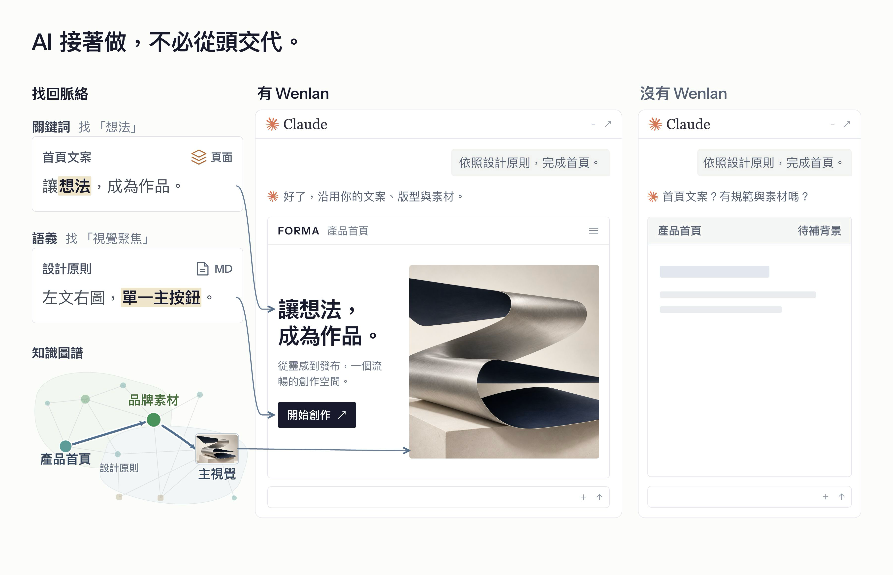
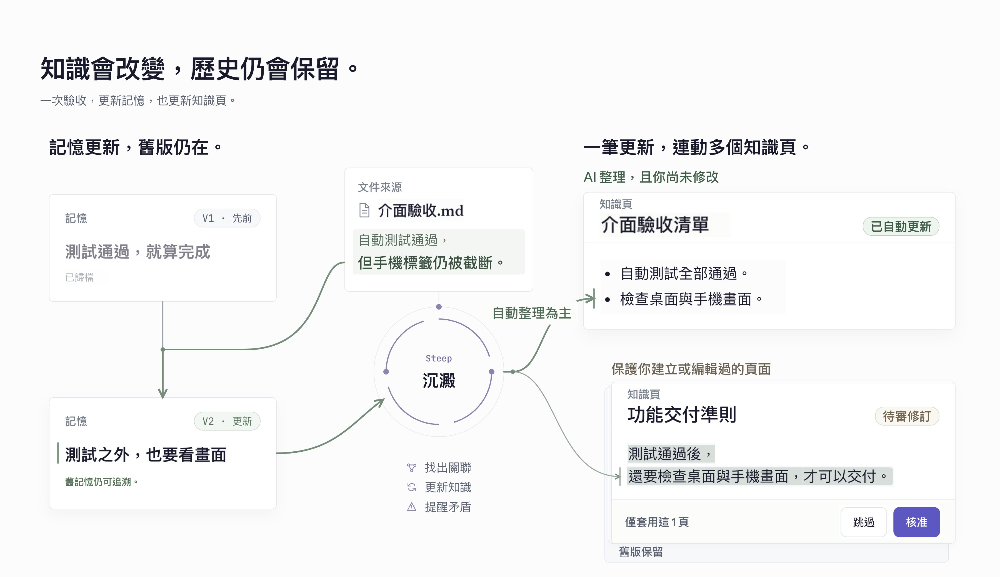

<!-- README_SYNC: source=README.md sha256=6de841b549c9e884e6ed47cf35a13226c270bcb81d348d58fcd7eed7897057cc -->

  <picture>
    <source media="(max-width: 600px)" srcset="./docs/assets/readme-banner-es-ES-mobile.png">
    
  </picture>

Wenlan organiza notas, documentos y conversaciones de IA en páginas editables con enlaces a sus fuentes, para que tú y las herramientas de IA conectadas podáis continuar lo que ya sabéis.

  <a href="./README.md">English</a> | <a href="./README.zh-Hans.md">简体中文</a> | <a href="./README.zh-Hant.md">繁體中文</a> | Español

  
  
  

  <a href="#start-in-30-seconds">Primeros&nbsp;pasos</a> ·
  <a href="#what-can-i-bring-in">Explorar&nbsp;y&nbsp;organizar</a> ·
  <a href="#retrieval">Usar&nbsp;con&nbsp;IA</a> ·
  <a href="#two-lifecycles">Mantener&nbsp;al&nbsp;día</a> ·
  <a href="#learn-more">Docs&nbsp;y&nbsp;comunidad</a> ·
  <a href="https://discord.gg/nmzVTTU3HG">Discord</a>

<!-- Replace the linked walkthrough when the separately produced release video is ready. -->

  
   <a href="https://github.com/user-attachments/assets/35f06749-00e5-484d-a9f4-5e462de8d11e">▶ Ver el vídeo</a>

Portada compuesta con varias vistas reales de la app y datos de ejemplo; el grafo es ilustrativo, no una pantalla nativa de tres columnas.

## Primeros pasos

### 1. Descarga y abre Wenlan

[Descarga la aplicación de escritorio](https://github.com/wenlan-app/wenlan/releases/latest) y ábrela:

- **macOS (Apple Silicon):** abre el `.dmg` y arrastra Wenlan a Aplicaciones. La aplicación está firmada y notarizada.
- **Windows x64:** ejecuta el `-setup.exe`; todavía no está firmado. Si SmartScreen avisa, confirma que procede de la página oficial de Releases antes de elegir «Más información» → «Ejecutar de todas formas».
- **Linux:** aún no hay aplicación de escritorio; sigue la [guía de configuración de IA](docs/setup-with-ai.md#install-the-runtime) para instalar el runtime.

Al iniciar por primera vez se descarga el modelo de búsqueda local. Mantén la conexión hasta terminar la configuración. [Detalles de descarga y privacidad](docs/PRIVACY.md#when-wenlan-reaches-the-network).

### 2. Abre un ejemplo o crea una página

Elige **Open notes** para entrar en Wenlan. Explora el ejemplo de bienvenida o crea una página propia.

### 3. Conecta una herramienta de IA cuando quieras

Conecta Claude Code, Codex u otro cliente compatible cuando quieras que use tus conocimientos guardados. Sigue la [guía para conectar IA](docs/setup-with-ai.md).

> Usa mis notas anteriores para ayudarme a terminar esta tarea.

## Explora y organiza tu conocimiento

Las fuentes son las notas, documentos y conversaciones originales que incorporas. Las Memorias conservan datos y decisiones útiles; las Páginas organizan conocimiento relacionado y enlazan a sus fuentes.

- **Importación de archivos y conversaciones:** Importa Markdown, texto, PDF con texto seleccionable, carpetas y ZIP de ChatGPT o Claude conservando las referencias a sus fuentes.
- **Conexión de solo lectura con Obsidian:** Lee una bóveda existente y actualízala bajo demanda sin modificar sus archivos ni sincronizar cambios de vuelta.
- **Quick Capture y Memorias atómicas:** Guarda decisiones, lecciones y preferencias individuales desde la app o mediante tu IA, con su procedencia.
- **Páginas Markdown con citas:** Organiza Fuentes y Memorias relacionadas en Páginas editables, con citas y `[[wikilinks]]` a otras Páginas.
- **Grafo y comunidades:** Con el enriquecimiento configurado, extrae Entidades y relaciones tipadas de las Memorias, identifica menciones repetidas y agrupa Entidades conectadas en comunidades.

Los PDF escaneados necesitan extracción de texto antes de importarlos.

### Explora tu grafo de conocimiento personal

  

Nodos y conexiones reales de la app; los nombres y límites de las regiones son ilustrativos.

## Usa tu conocimiento con IA

- **MCP y plugins de IA:** Claude Code, Codex y otros clientes conectados leen y escriben el mismo conocimiento local mediante las herramientas de Wenlan.
- **Búsqueda híbrida local:** Combina búsqueda de texto completo con SQLite FTS5 y embeddings BGE mediante Reciprocal Rank Fusion (RRF) ponderado, sin clave API para la búsqueda base.
- **Clasificación asistida por el grafo:** Los enlaces válidos entre Entidades elevan la posición de Memorias candidatas relacionadas, y un reranking cross-encoder opcional puede refinar los resultados.
- **Captura y traspaso de trabajo:** Usa `/capture` para guardar decisiones con contexto y `/handoff` para conservar el progreso y las preguntas pendientes para la siguiente sesión.
- **Búsqueda por Espacio:** Selecciona un Espacio para limitar el conocimiento devuelto al proyecto o colección personal pertinente.

  

Ilustración conceptual con un proyecto y conversaciones ficticios; no es una prueba del producto. La diferencia es el contexto adicional de Wenlan, junto con las capacidades propias de Claude, incluida su memoria nativa.

[Cómo funciona la búsqueda](docs/technical-foundations.md#retrieval-pipeline).

El acceso web experimental permite que clientes compatibles busquen en toda la biblioteca o en un Espacio elegido, mientras el ordenador con Wenlan permanece conectado. Las consultas y los resultados pasan por un relay; consulta sus [límites de privacidad](docs/PRIVACY.md#pre-release-standalone-wenlan-relay-connector).

## Mantén el conocimiento al día y conserva su historial

- **Seguimiento de evidencias y actualización:** Sigue las Fuentes y Memorias que sustentan cada Página para actualizar Páginas obsoletas con evidencia actual.
- **Enriquecimiento en segundo plano con Steep:** Con un [modelo configurado](docs/setup-and-data.es-ES.md#models), añade tipos, datos estructurados, pistas de búsqueda y enlaces al grafo, y activa la síntesis opcional de Páginas.
- **Revisión e historial:** La actualización automática propone cambios en Páginas que hayas editado y conserva versiones de Páginas y cadenas explícitas de sustitución de Memorias para su consulta.
- **Markdown local y exportación de wikis:** Conserva Páginas como archivos Markdown y exporta las que cumplan los requisitos como una wiki OKF, con Memorias y grafo almacenados en libSQL local.
- **Elige cómo ejecutar los modelos:** Usa Qwen en el dispositivo mediante llama.cpp, un servidor local compatible con OpenAI como Ollama o LM Studio, o un proveedor de nube configurado para enriquecimiento y síntesis.

  

Vistas reales de la app con datos de ejemplo; las conexiones y etiquetas son ilustrativas.

La actualización automática rechaza borradores con citas insuficientes; las ediciones directas de archivos y la regeneración forzada siguen otras reglas de revisión.

[Actualizaciones y revisión](docs/knowledge-guide.es-ES.md#updates-and-history) · [Diagnóstico e incidencias](https://wenlan.app/docs/diagnostics-and-issue-reports).

## Un flujo de trabajo sencillo

Encuentra conocimiento previo → guarda decisiones útiles → organízalas en Páginas → retómalas en la siguiente tarea. El plugin de Wenlan añade `/recall`, `/capture`, `/distill` y `/handoff` ([comandos](plugin/skills/README.md)).

### Datos y privacidad

Las Páginas y notas de sesión son archivos Markdown; las Memorias y el grafo se guardan en una base de datos local. Un cliente de IA en la nube puede enviarle el conocimiento recuperado a su proveedor; un modelo en la nube también recibe el contenido que procesa. El almacenamiento local no mantiene locales esas interacciones. Las estadísticas de uso están desactivadas por defecto.

[Ubicación de archivos, copias y eliminación](docs/setup-and-data.es-ES.md#backup-and-removal) · [Red y privacidad](docs/PRIVACY.md#when-wenlan-reaches-the-network).

## Evaluación

Estos resultados indican si la búsqueda encuentra conocimiento relacionado; no miden la calidad de las respuestas de IA.

Métricas de búsqueda

<!-- EVAL_SNAPSHOT_START -->
| Benchmark | Recall@5 | MRR | NDCG@10 |
|---|---:|---:|---:|
| LME_Oracle (500 Q) | 93.6% | 0.857 | 0.883 |
| LME_S (deep, 90 Q) | 87.7% | 0.815 | 0.822 |
<!-- EVAL_SNAPSHOT_END -->

[Método de evaluación y detalles del benchmark](docs/eval/README.md).

## Leer más

Guías para empezar y consultar los detalles del flujo de trabajo:

- [Primeros pasos e instalación](docs/setup-and-data.es-ES.md#installation)
- [Conectar una herramienta de IA](docs/setup-with-ai.md)
- [Fuentes e importaciones](docs/knowledge-guide.es-ES.md#sources-and-pages) · [Archivos locales, copias y uso sin conexión](docs/setup-and-data.es-ES.md)
- [Privacidad](docs/PRIVACY.md)
- [Índice completo de documentación](docs/README.md)

## Contribuir

Únete a la [comunidad de Discord](https://discord.gg/nmzVTTU3HG). Informa de errores o pide funciones en [GitHub issues](https://github.com/wenlan-app/wenlan/issues); son públicos, así que oculta secretos y datos personales. Para contribuir con código o documentación, consulta [Contribuir](.github/CONTRIBUTING.md), [Seguridad](.github/SECURITY.md) y el [Código de Conducta](.github/CODE_OF_CONDUCT.md).

## Política de firma de código

Consulta los [detalles de firma y notarización por plataforma](docs/code-signing.md).

## Licencia

El runtime local, la CLI, el servidor MCP, los tipos compartidos y los plugins usan [Apache-2.0](LICENSE). La aplicación de escritorio y su frontend usan [AGPL-3.0-only](app/LICENSE); si ejecutas una versión modificada como servicio de red, debes ofrecer su código fuente a los usuarios.

## Linaje y proyectos afines

Wenlan toma su nombre del Pabellón Wenlan y continúa las tradiciones de LLM-wiki y agent-memory: [la nota LLM-wiki de Karpathy](https://gist.github.com/karpathy/442a6bf555914893e9891c11519de94f), [la propuesta de Rohitg00](https://gist.github.com/rohitg00/2067ab416f7bbe447c1977edaaa681e2) y [nashsu/llm_wiki](https://github.com/nashsu/llm_wiki).
