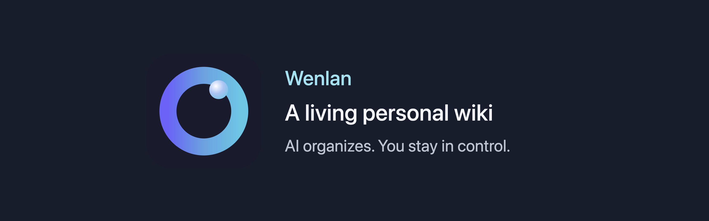
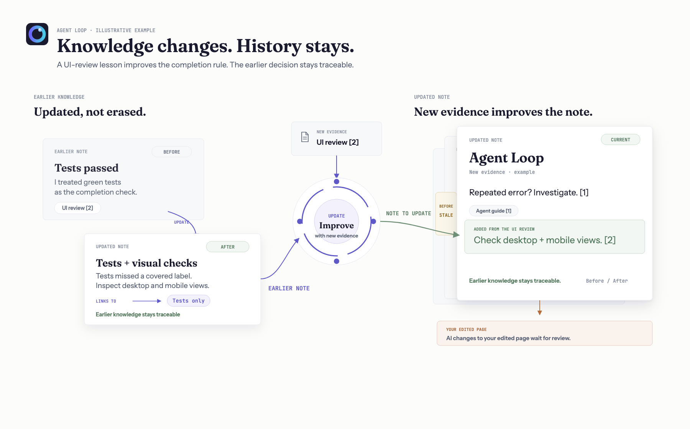

  <picture>
    <source media="(max-width: 600px)" srcset="./docs/assets/readme-banner-mobile.png">
    
  </picture>

Wenlan organizes notes, documents, and AI conversations into editable, source-linked pages, so you and connected AI tools can build on what you already know.

  English | <a href="./README.zh-Hans.md">简体中文</a> | <a href="./README.zh-Hant.md">繁體中文</a> | <a href="./README.es-ES.md">Español</a>

  
  
  

  <a href="#start-in-30-seconds">Get&nbsp;started</a> ·
  <a href="#what-can-i-bring-in">Browse&nbsp;and&nbsp;organize</a> ·
  <a href="#retrieval">Use&nbsp;with&nbsp;AI</a> ·
  <a href="#two-lifecycles">Keep&nbsp;knowledge&nbsp;current</a> ·
  <a href="#learn-more">Docs&nbsp;and&nbsp;community</a> ·
  <a href="https://discord.gg/nmzVTTU3HG">Discord</a>

<!-- Replace the linked walkthrough when the separately produced release video is ready. -->

  
   <a href="https://github.com/user-attachments/assets/35f06749-00e5-484d-a9f4-5e462de8d11e">▶ Watch the video</a>
   Cover composed from actual App views and demo data.

## Get started

### 1. Download and open Wenlan

[Download the desktop app](https://github.com/wenlan-app/wenlan/releases/latest), then open it:

- **macOS (Apple Silicon):** Open the `.dmg` and drag Wenlan to Applications. The app is signed and notarized.
- **Windows x64:** Run the `-setup.exe`; it is not signed yet. If SmartScreen warns you, confirm it came from the official Releases page before choosing “More info” → “Run anyway.”
- **Linux:** There is no desktop app yet; use the [AI setup guide](docs/setup-with-ai.md#install-the-runtime) to install the runtime.

First launch downloads the local search model. Keep an internet connection until setup finishes. [Download and privacy details](docs/PRIVACY.md#when-wenlan-reaches-the-network).

### 2. Open a sample or create a page

Choose **Open notes** to enter Wenlan. Explore the sample from the welcome screen or create a page of your own.

### 3. Connect an AI tool when you want

Connect Claude Code, Codex, or another supported client when you want it to use your saved knowledge. Follow the [AI setup guide](docs/setup-with-ai.md).

> Use what I’ve saved about [topic] to draft a page for [next task]. Cite the sources you rely on.

## Browse and organize your knowledge

Sources are the original notes, documents, and conversations you bring in. Memories preserve useful facts and decisions; Pages organize related knowledge and link back to sources.

Import Markdown, text files, text-based PDFs, folders, and ChatGPT or Claude export ZIPs. Scanned PDFs need text extraction first.

### Explore your personal knowledge graph

  
   Illustration rearranged from actual App demo data; real relationships preserved.

Browse Pages and connected concepts, and open citations to inspect the original sources.

Connect an Obsidian vault as a read-only source. Wenlan does not modify it or sync changes back; refresh it on demand.

## Use your knowledge with AI

Connect Claude Code or Codex so the next task can draw on what you already know. Wenlan searches matching keywords, related meaning, and links across your knowledge graph.

  
   Concept illustration: fictional project and conversations, not a measured comparison.

[How search works](docs/technical-foundations.md#retrieval-pipeline).

Experimental web access lets supported web clients search the whole library or one chosen Space while the computer running Wenlan stays online. Queries and results pass through a relay; see the [privacy limits](docs/PRIVACY.md#pre-release-standalone-wenlan-relay-connector).

## Keep knowledge current and preserve history

Sources can change over time. Ask AI to update a Page, or enable optional background organization and updates with a [configured model](docs/setup-and-data.md#models).

  <picture>
    <source media="(max-width: 900px)" srcset="./docs/assets/wenlan-lifecycle-mobile.png">
    
  </picture>

File and folder Sources track changes. Automatic refresh rejects drafts without enough citations. Updates to Pages you have edited become review proposals; direct file edits and forced regeneration follow different rules.

[Updates and review](docs/knowledge-guide.md#updates-and-history) · [Doctor and issue reports](https://wenlan.app/docs/diagnostics-and-issue-reports).

## A simple workflow

Find prior knowledge → save useful decisions → organize them into Pages → pick up next time. The Wenlan plugin adds `/recall`, `/capture`, `/distill`, and `/handoff` ([commands](plugin/skills/README.md)).

### Data and privacy

Pages and session notes are Markdown files; Memories and graph data are stored in a local database. A cloud AI client may send retrieved knowledge to its provider, and a cloud model receives the material it processes. Local storage does not keep those interactions local. Usage statistics are off by default.

[File locations, backup, and removal](docs/setup-and-data.md#backup-and-removal) · [Network and privacy details](docs/PRIVACY.md#when-wenlan-reaches-the-network).

## Evaluation

These results show whether Wenlan search finds related saved knowledge; they do not measure the quality of AI answers.

Search metrics

<!-- EVAL_SNAPSHOT_START -->
| Benchmark | Recall@5 | MRR | NDCG@10 |
|---|---:|---:|---:|
| LME_Oracle (500 Q) | 93.6% | 0.857 | 0.883 |
| LME_S (deep, 90 Q) | 87.7% | 0.815 | 0.822 |
<!-- EVAL_SNAPSHOT_END -->

[Evaluation method and benchmark details](docs/eval/README.md).

## Learn more

Guides for the first steps and the details behind the workflow:

- [Get started and install](docs/setup-and-data.md#installation)
- [Connect an AI tool](docs/setup-with-ai.md)
- [Sources and imports](docs/knowledge-guide.md#sources-and-pages) · [Local files, backups, and offline use](docs/setup-and-data.md)
- [Privacy](docs/PRIVACY.md)
- [Full documentation index](docs/README.md)

## Contributing

Join the [Discord community](https://discord.gg/nmzVTTU3HG). Report bugs or request features in [GitHub issues](https://github.com/wenlan-app/wenlan/issues); issues are public, so redact secrets and personal information. For code and docs, see [Contributing](.github/CONTRIBUTING.md), [Security](.github/SECURITY.md), and the [Code of Conduct](.github/CODE_OF_CONDUCT.md).

## Code signing policy

See the [platform signing and notarization details](docs/code-signing.md).

## License

The local runtime, CLI, MCP server, shared types, and plugins use [Apache-2.0](LICENSE). The desktop app and its frontend use [AGPL-3.0-only](app/LICENSE); modified versions run as a network service must offer their source to users.

## Lineage and peers

Wenlan takes its name from Wenlan Pavilion. Its direction builds on the LLM-wiki and agent-memory lineages: [Karpathy’s LLM-wiki note](https://gist.github.com/karpathy/442a6bf555914893e9891c11519de94f), [Rohitg00’s proposal](https://gist.github.com/rohitg00/2067ab416f7bbe447c1977edaaa681e2), and [nashsu/llm_wiki](https://github.com/nashsu/llm_wiki).
