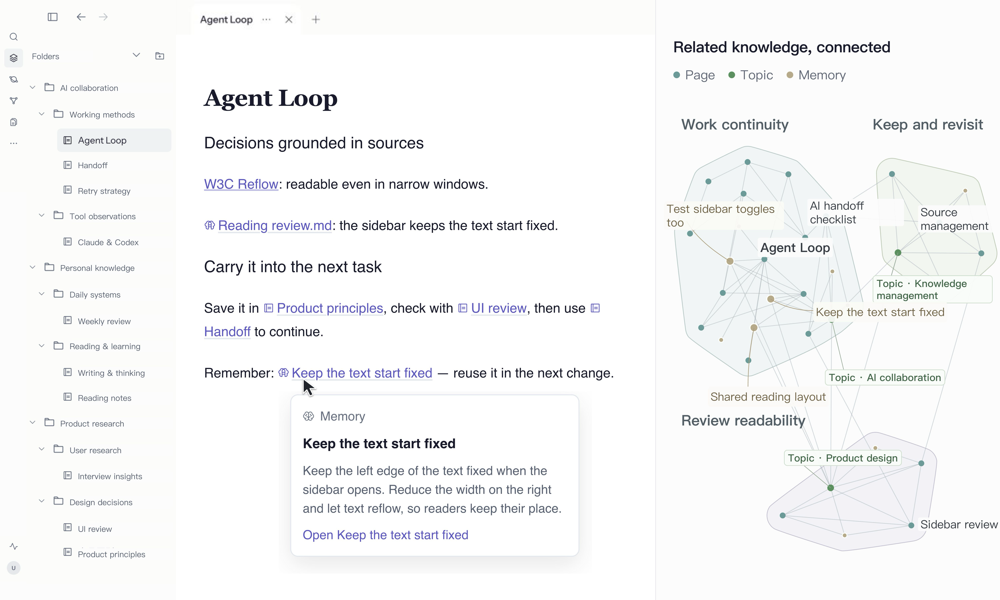
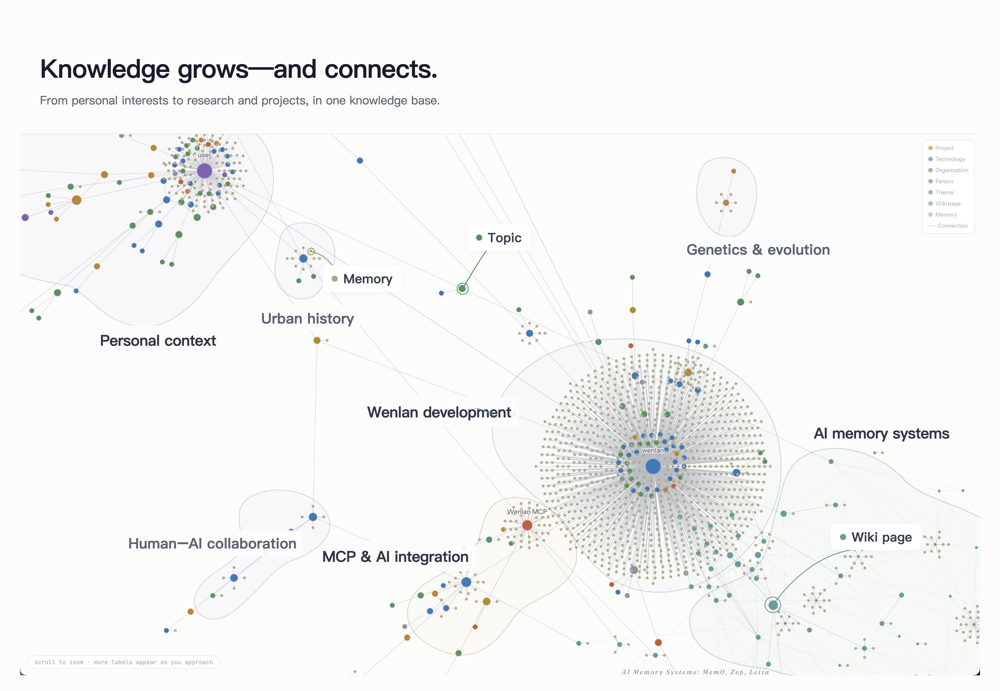
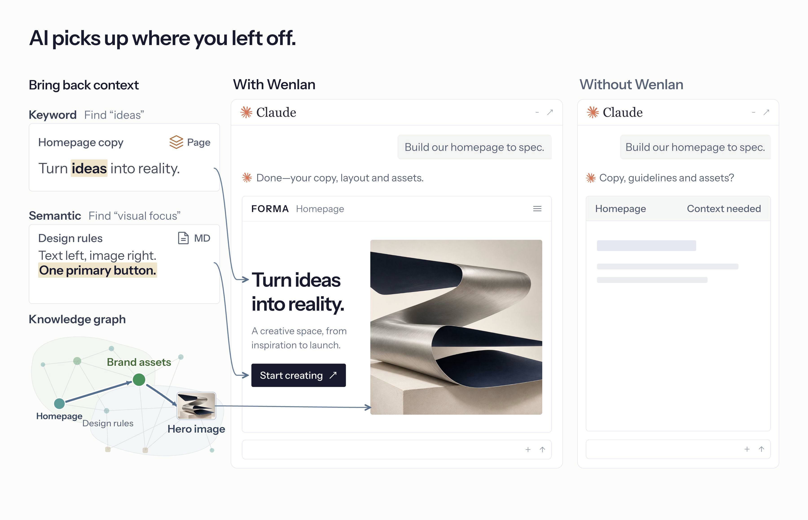
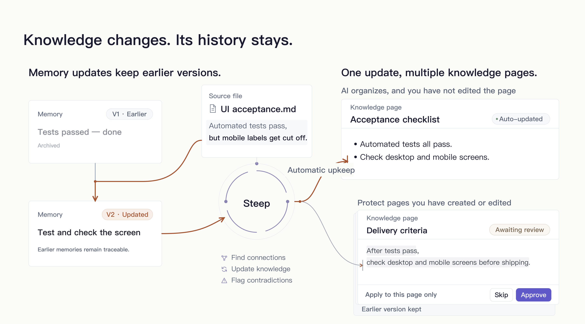
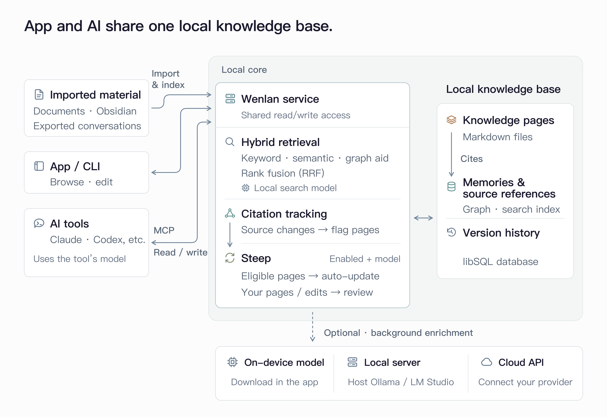

  <picture>
    <source media="(max-width: 600px)" srcset="./docs/assets/readme-banner-mobile.png">
    
  </picture>

  Wenlan organizes scattered notes, documents, and conversations into a knowledge base that stays current and links back to its sources, 
  so you and AI tools like Claude and Codex can use it to find answers and get work done.

  English | <a href="./README.zh-Hans.md">简体中文</a> | <a href="./README.zh-Hant.md">繁體中文</a> | <a href="./README.es-ES.md">Español</a>

  
  
  

  <a href="#start-in-30-seconds">Get&nbsp;started</a> ·
  <a href="#what-can-i-bring-in">Capabilities</a> ·
  <a href="#learn-more">Docs</a> ·
  <a href="https://discord.gg/nmzVTTU3HG">Discord</a>

<!-- Replace the linked walkthrough when the separately produced release video is ready. -->

  
   <a href="https://github.com/user-attachments/assets/35f06749-00e5-484d-a9f4-5e462de8d11e">▶ Watch the video</a>

Localized composite of App views with demo data; the graph is illustrative, not a native three-column layout.

## Get started

### 1. Download and open Wenlan

[Download the desktop app](https://github.com/wenlan-app/wenlan/releases/latest), then open it:

- **macOS (Apple Silicon):** Open the `.dmg` and drag Wenlan to Applications. The app is signed and notarized.
- **Windows x64:** Run the `-setup.exe`; it is not signed yet. If SmartScreen warns you, confirm it came from the official Releases page before choosing “More info” → “Run anyway.”
- **Linux:** There is no desktop app yet; use the [AI setup guide](docs/setup-with-ai.md#install-the-runtime) to install the runtime.

First launch downloads the local search model. Keep an internet connection until setup finishes. [Download and privacy details](docs/PRIVACY.md#when-wenlan-reaches-the-network).

You can also [use Wenlan without the desktop app](docs/setup-and-data.md#installation) through AI tools or the CLI, with the same local knowledge base.

### 2. Open a sample or create a page

Choose **Open notes** to enter Wenlan. Explore the sample from the welcome screen or create a page of your own.

### 3. Connect an AI tool when you want

| AI tool | Connection | Setup |
|---|---|---|
| Claude Code | Plugin | [Claude Code guide](docs/setup-with-ai.md#claude-code) |
| Codex | Plugin | [Codex guide](docs/setup-with-ai.md#codex) |
| Cursor, Claude Desktop, VS Code, Gemini CLI | MCP | [MCP guide](docs/setup-with-ai.md#mcp-only-setup-and-other-clients) |

After installing a plugin, start a new AI session and run `/setup`. Connecting your AI needs no additional local language model.

> Use my earlier notes to help me finish this task.

**First success:** Your AI finds the saved note or imported document you asked for and cites a source you can check.

## Organize scattered material into knowledge

Edit **Markdown pages with citations** and link related content through `[[wikilinks]]`. Follow a citation to check the original document, conversation, or saved memory behind an idea.

- **File and conversation imports:** Import Markdown, text, text-based PDFs, folders, and ChatGPT or Claude export ZIPs while retaining source references. Scanned PDFs need text extraction before import. Chat imports preserve a snapshot; registered file sources can refresh from disk.
- **Read-only Obsidian connection:** Read an existing vault and refresh it on demand without modifying its files or syncing changes back.
- **Quick Capture and atomic memories:** Save one decision, lesson, or preference at a time in the app or through your AI, with its source.
- **Knowledge graph:** Discover related topics through typed entities, relations, and knowledge clusters (communities); a configured enrichment model links repeated mentions to the same entity (mention resolution).

  

App nodes and connections; translated labels and illustrative regions.

## Put your knowledge to work with AI

**Plugins** guide your AI on when to search and save; **MCP-only connections** provide tools the AI can call as needed or at your request.

- **[Local hybrid retrieval](docs/technical-foundations.md#retrieval-pipeline):** Find exact terms and similar meaning with SQLite FTS5 and BGE embeddings, fused by weighted Reciprocal Rank Fusion (RRF); base search needs no API key.
- **Graph-assisted ranking:** Rank related memories higher when entity links are available, with optional cross-encoder reranking to refine relevance.
- **Plugin workflow:** Find context with `/recall`, save decisions with `/capture`, synthesize pages with `/distill`, and leave progress and open questions with `/handoff` ([commands](plugin/skills/README.md)).
- **Space-scoped retrieval:** Select a Space to limit returned knowledge to the relevant project or personal collection.

  

Fictional example, not a product test; Wenlan adds context alongside Claude’s native memory.

Experimental web access lets supported web clients search the whole library or one chosen Space while the computer running Wenlan stays online. Queries and results pass through a relay; see the [privacy limits](docs/PRIVACY.md#pre-release-standalone-wenlan-relay-connector).

## Keep knowledge current, with its history

- **Steep background enrichment:** Prepare captured memories for reuse with types, structured details, search cues, and graph links; page synthesis is optional.
- **[Revision review and history](docs/knowledge-guide.md#updates-and-history):** Compare page versions and trace memory replacements; automatic refresh updates eligible machine-maintained pages directly and proposes revisions for pages you edited.
- **Wiki export:** Export eligible pages as an Open Knowledge Format (OKF) wiki.
- **[Optional background models](docs/setup-and-data.md#models):** Enable enrichment, synthesis, and automatic refresh with on-device Qwen (llama.cpp), local OpenAI-compatible servers such as Ollama or LM Studio, or configured cloud providers.

  

Localized App-view composite with demo data; connections are illustrative.

## Architecture

**One local knowledge base.** App, CLI, and connected AI tools read and write through Wenlan’s local service. Pages are Markdown files; memories, relationships, and search indexes live in local libSQL.

**Updates follow citations.** When a cited source or memory changes or is removed in Wenlan, evidence tracking marks affected pages. With background AI enabled and a model available, eligible pages refresh; drafts with insufficient citations are rejected.

  

Architecture overview. [Retrieval, evidence, and models](docs/technical-foundations.md).

## Data and privacy

A cloud AI client may send retrieved knowledge to its provider, and a cloud model receives the material it processes. Local storage does not keep those interactions local. Usage statistics are off by default.

[File locations, backup, and removal](docs/setup-and-data.md#backup-and-removal) · [Network and privacy details](docs/PRIVACY.md#when-wenlan-reaches-the-network).

## Evaluation

These results show whether Wenlan search finds related saved knowledge; they do not measure the quality of AI answers.

<!-- EVAL_SNAPSHOT_START -->
| Benchmark | Recall@5 | MRR | NDCG@10 |
|---|---:|---:|---:|
| LME_Oracle (500 Q) | 93.6% | 0.857 | 0.883 |
| LME_S (deep, 90 Q) | 87.7% | 0.815 | 0.822 |
<!-- EVAL_SNAPSHOT_END -->

[Evaluation method and benchmark details](docs/eval/README.md).

## Learn more

- [Get started and install](docs/setup-and-data.md#installation)
- [Connect an AI tool](docs/setup-with-ai.md)
- [Sources and imports](docs/knowledge-guide.md#sources-and-pages) · [Local files, backups, and offline use](docs/setup-and-data.md)
- [Privacy](docs/PRIVACY.md)
- [Doctor and issue reports](https://wenlan.app/docs/diagnostics-and-issue-reports)
- [Full documentation index](docs/README.md)

## Contributing

Join the [Discord community](https://discord.gg/nmzVTTU3HG). Report bugs or request features in [GitHub issues](https://github.com/wenlan-app/wenlan/issues); issues are public, so redact secrets and personal information. For code and docs, see [Contributing](.github/CONTRIBUTING.md), [Security](.github/SECURITY.md), and the [Code of Conduct](.github/CODE_OF_CONDUCT.md).

## Code signing policy

See the [platform signing and notarization details](docs/code-signing.md).

## License

The local runtime, CLI, MCP server, shared types, and plugins use [Apache-2.0](LICENSE). The desktop app and its frontend use [AGPL-3.0-only](app/LICENSE); modified versions run as a network service must offer their source to users.

## Lineage and peers

Wenlan takes its name from Wenlan Pavilion. Its direction builds on the LLM-wiki and agent-memory lineages: [Karpathy’s LLM-wiki note](https://gist.github.com/karpathy/442a6bf555914893e9891c11519de94f), [Rohitg00’s proposal](https://gist.github.com/rohitg00/2067ab416f7bbe447c1977edaaa681e2), and [nashsu/llm_wiki](https://github.com/nashsu/llm_wiki).
