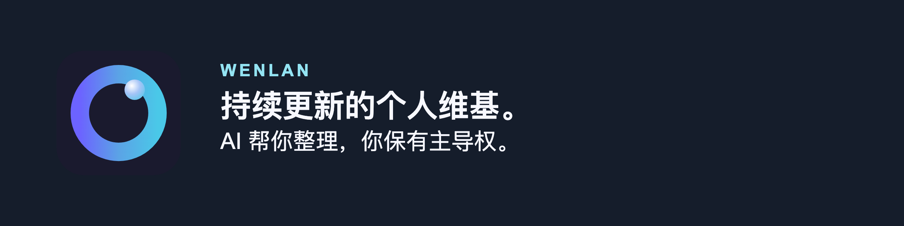
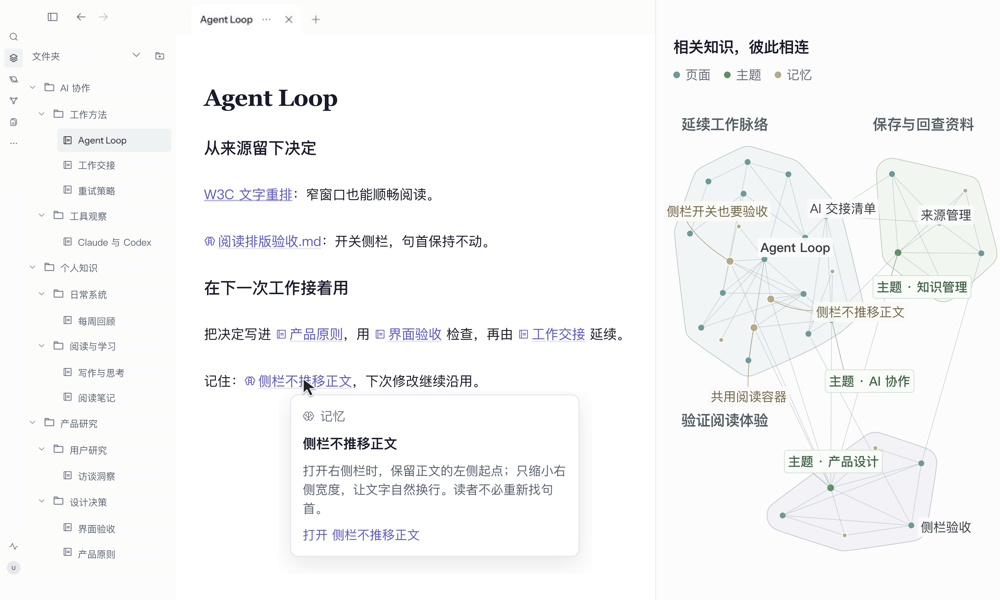
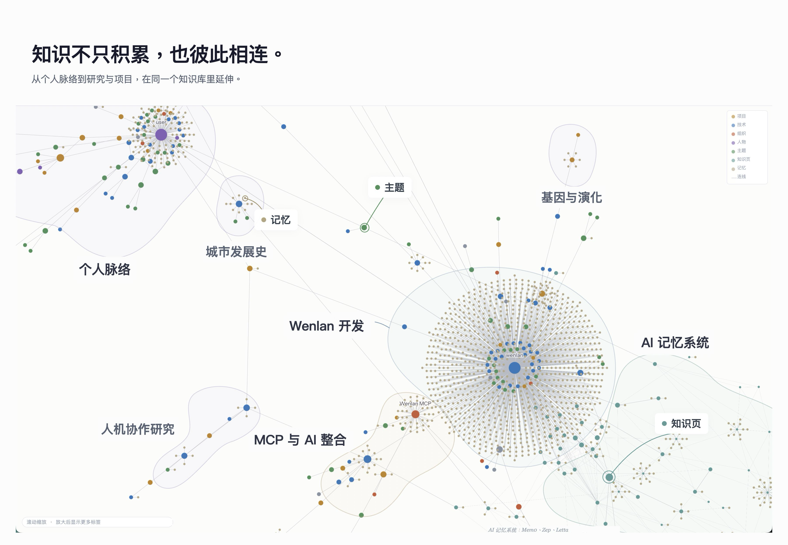
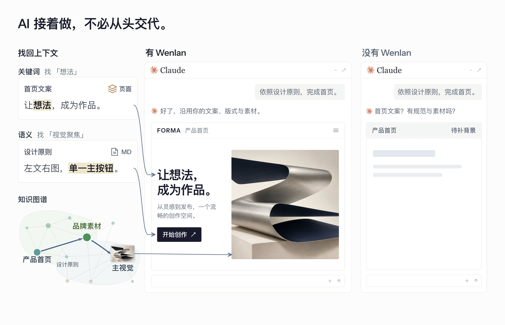
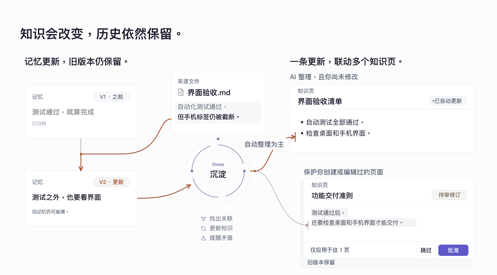
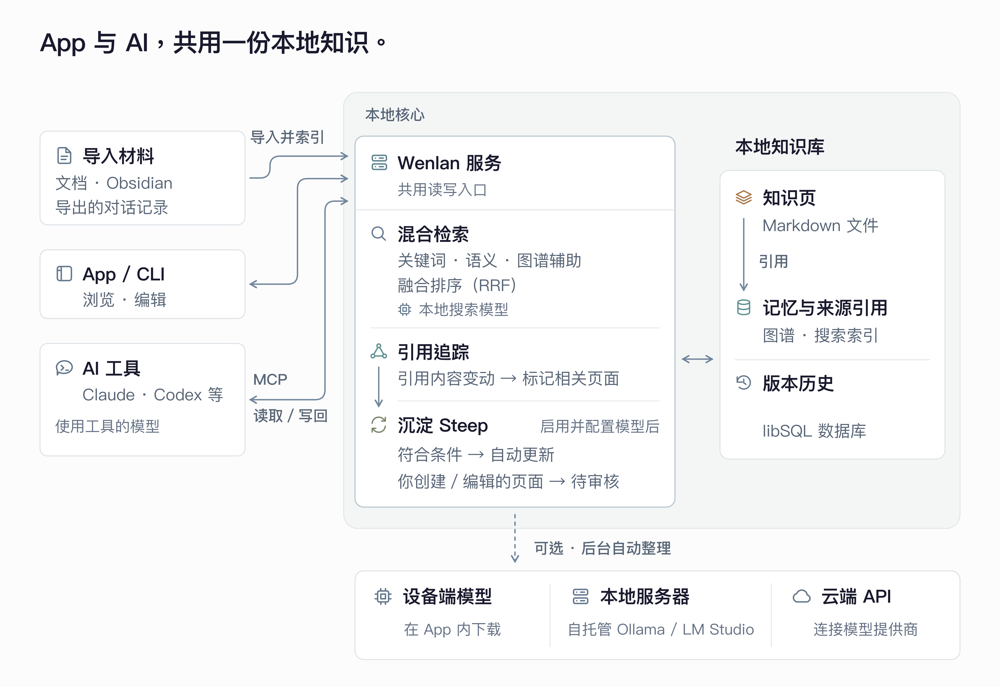

<!-- README_SYNC: source=README.md sha256=f927704bc4df94ee55e6503a39f280bbc0958551c832cb2db0d235d10dfb5285 -->

  <picture>
    <source media="(max-width: 600px)" srcset="./docs/assets/readme-banner-zh-Hans-mobile.png">
    
  </picture>

  文澜将散落的笔记、文档与对话，整理成持续更新、来源可查的知识库， 
  让你和 Claude、Codex 等 AI 工具用来找到答案、完成工作。

  <a href="./README.md">English</a> | 简体中文 | <a href="./README.zh-Hant.md">繁體中文</a> | <a href="./README.es-ES.md">Español</a>

  
  
  

  <a href="#start-in-30-seconds">开&#8288;始&#8288;使&#8288;用</a> ·
  <a href="#what-can-i-bring-in">功&#8288;能</a> ·
  <a href="#learn-more">文&#8288;档</a> ·
  <a href="https://discord.gg/nmzVTTU3HG">Discord</a>

<!-- Replace the linked walkthrough when the separately produced release video is ready. -->

  
   <a href="https://github.com/user-attachments/assets/2c91437c-59f5-44af-a5e1-da7627b921ad">▶ 观看影片</a>

实机画面与示范数据的翻译合成图；图谱为示意，非 App 原生三栏版面。

## 开始使用

### 1. 下载并打开 Wenlan

[下载桌面版](https://github.com/wenlan-app/wenlan/releases/latest)，安装后打开：

- **macOS（Apple Silicon）：** 打开 `.dmg`，把 Wenlan 拖进“应用程序”。App 已签名并通过公证。
- **Windows x64：** 运行 `-setup.exe`，安装包尚未签名。若 SmartScreen 警告，请先确认文件来自官方 Releases 页面，再选“更多信息”→“仍要运行”。
- **Linux：** 暂无桌面版；请按[AI 设置指南](docs/setup-with-ai.md#install-the-runtime)安装 runtime。

首次启动会下载本地搜索模型，设置完成前请保持联网。[下载与隐私说明](docs/PRIVACY.md#when-wenlan-reaches-the-network)。

也可[不安装桌面应用](docs/setup-and-data.zh-Hans.md#installation)，通过 AI 或 CLI 使用同一个本地知识库。

### 2. 打开示例或创建页面

选择“打开笔记”进入 Wenlan，可先看欢迎页中的示例，也可以创建自己的页面。

### 3. 需要时再连接 AI 工具

Claude Code 和 Codex 可使用插件；Cursor、Claude Desktop、VS Code 和 Gemini CLI 可通过 MCP 连接（[设置指南](docs/setup-with-ai.md)）。已连接的 AI 就能使用你保存的知识并撰写页面，无需另装本地语言模型。若要后台整理和自动更新，则需[另外配置模型](docs/setup-and-data.zh-Hans.md#models)。

> 参考我之前的笔记，帮我接着完成这个任务。

先用一则已保存的笔记或导入的文件试做，请 AI 引用所用来源，让你能回头核对成果的依据。

## 把散落的资料整理成知识

编辑**带有引用的 Markdown 页面**，用 `[[wikilinks]]` 串起相关内容。点开引用，就能核对原始文档、对话或保存的记忆。

- **文件与对话导入**：导入 Markdown、文本文件、文本型 PDF、文件夹，以及 ChatGPT 或 Claude 导出的 ZIP，保留来源引用。扫描版 PDF 需先提取文本再导入。对话导入保留当时记录；已注册的文件来源可刷新为最新内容。
- **Obsidian 只读连接**：读取已有仓库并按需刷新，不修改原始文件，也不将变化同步回去。
- **Quick Capture 与原子记忆**：在 App 或通过 AI，每次保存一条决定、经验或偏好，并保留其来源。
- **知识图谱**：通过不同类型的实体、关系与知识群集（communities），发现相关主题；配置整理模型后，将重复提及连接到同一实体。

  

保留实机节点与连线；文字经翻译，区域名称与范围为示意。

## 让 AI 接续已有知识

用上已有知识，保存新经验。**插件**提供何时搜索和保存的指引；**仅连接 MCP** 则提供工具，由 AI 按任务需要或你的要求调用。

- **[本地混合检索（Hybrid Retrieval）](docs/technical-foundations.md#retrieval-pipeline)**：用 SQLite FTS5 找出相同词句、BGE 向量找出相近语义，再以加权 RRF 合并排名；基础搜索无需 API key。
- **图谱辅助排序**：有可用的实体连接时，提高相关记忆的排名，也可选用 cross-encoder reranking 精排结果。
- **插件工作流程**：用 `/recall` 找上下文、`/capture` 存决定、`/distill` 合成页面，并用 `/handoff` 留下进度与待解问题（[指令说明](plugin/skills/README.md)）。
- **Spaces 范围检索**：选定 Space，将返回的知识限制在相关项目或个人资料集合内。

  

虚构案例，非产品测试；文澜补充上下文，与 Claude 原生记忆配合使用。

实验中的网页访问功能可让受支持的客户端搜索整个资料库或指定空间，但运行 Wenlan 的电脑必须保持联网。查询与结果会经过中继服务，详见[隐私边界](docs/PRIVACY.md#pre-release-standalone-wenlan-relay-connector)。

## 更新知识，保留历史

- **Steep 后台整理**：配置[模型](docs/setup-and-data.zh-Hans.md#models)后，为记忆补上类型、结构化信息、搜索线索与图谱连接；页面合成可选用。
- **[修订审核与历史](docs/knowledge-guide.zh-Hans.md#updates-and-history)**：比较页面版本、追溯记忆的替代关系；自动更新时，符合条件的 AI 维护页面直接更新，你编辑过的页面则提出修订供审核。
- **维基导出**：将符合条件的页面导出为 Open Knowledge Format（OKF）维基。
- **自由选择模型运行方式**：用设备端 Qwen（llama.cpp）、Ollama 或 LM Studio 等 OpenAI 兼容本地服务，或已配置的云端提供商运行整理与页面合成。

  

实机画面的翻译合成图，搭配示范数据；连线为示意。

自动更新会拒绝引用不足的草稿。

## 系统架构

**共用本地知识库。** App、CLI 与 AI 工具通过 Wenlan 本地服务读写。页面以 Markdown 保存；记忆、关系与搜索索引由本地 libSQL 管理。

**沿引用关系更新。** 来源或记忆在 Wenlan 中更新或移除时，依据追踪会标记相关页面；启用后台 AI 并有可用模型后，再依更新与审核条件整理。

  

架构示意。[检索、引用与模型](docs/technical-foundations.md)。

## 数据与隐私

云端 AI 客户端可能会把找回的知识传给其服务商，云端模型也会收到它处理所需的内容。本地存储不代表这些交互都留在本机。使用统计默认关闭。

[文件位置、备份与卸载](docs/setup-and-data.zh-Hans.md#backup-and-removal) · [联网与隐私详情](docs/PRIVACY.md#when-wenlan-reaches-the-network)。

## 评估

这些结果用来检查搜索能否找到相关知识，不代表 AI 回答质量。

<!-- EVAL_SNAPSHOT_START -->
| Benchmark | Recall@5 | MRR | NDCG@10 |
|---|---:|---:|---:|
| LME_Oracle (500 Q) | 93.6% | 0.857 | 0.883 |
| LME_S (deep, 90 Q) | 87.7% | 0.815 | 0.822 |
<!-- EVAL_SNAPSHOT_END -->

[评估方法与基准详情](docs/eval/README.md)。

## 进一步了解

- [开始使用与安装](docs/setup-and-data.zh-Hans.md#installation)
- [连接 AI 工具](docs/setup-with-ai.md)
- [来源与导入](docs/knowledge-guide.zh-Hans.md#sources-and-pages) · [本地文件、备份与离线使用](docs/setup-and-data.zh-Hans.md)
- [隐私](docs/PRIVACY.md)
- [Doctor 与问题反馈](https://wenlan.app/docs/diagnostics-and-issue-reports)
- [完整文档索引](docs/README.md)

## 贡献

欢迎加入 [Discord 社区](https://discord.gg/nmzVTTU3HG)。请在 [GitHub issues](https://github.com/wenlan-app/wenlan/issues) 反馈问题或提出功能建议；Issue 公开可见，分享前请遮盖密钥和个人资料。代码与文档贡献请见[贡献指南](.github/CONTRIBUTING.md)、[安全问题反馈](.github/SECURITY.md)和[行为准则](.github/CODE_OF_CONDUCT.md)。

## 代码签名政策

请见[各平台签名与公证说明](docs/code-signing.md)。

## 许可

本地 runtime、CLI、MCP server、shared types 和 plugins 使用 [Apache-2.0](LICENSE)。桌面 app 及其前端使用 [AGPL-3.0-only](app/LICENSE)；修改版若作为网络服务运行，须向用户提供其源代码。

## 源流与同类项目

Wenlan 名称来自文澜阁，产品方向承接 LLM-wiki 与 agent-memory 脉络：[Karpathy 的 LLM-wiki note](https://gist.github.com/karpathy/442a6bf555914893e9891c11519de94f)、[Rohitg00 的提案](https://gist.github.com/rohitg00/2067ab416f7bbe447c1977edaaa681e2)和 [nashsu/llm_wiki](https://github.com/nashsu/llm_wiki)。
