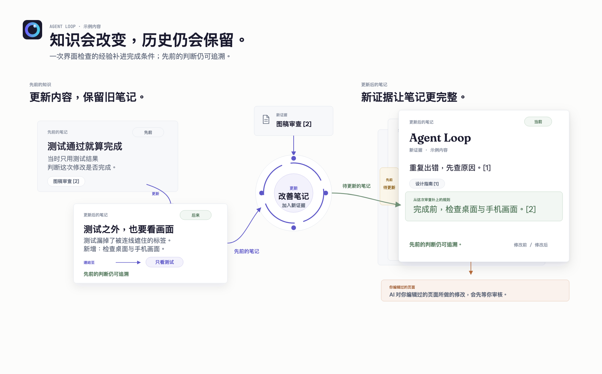

<!-- README_SYNC: source=README.md sha256=dd54d0971e48eacf7cc1f676497781b2898fdd15b9f4819928889926cfb879c4 -->

  <picture>
    <source media="(max-width: 600px)" srcset="./docs/assets/readme-banner-zh-Hans-mobile.png">
    
  </picture>

Wenlan 将笔记、文档和 AI 对话整理成可编辑且链接回来源的页面，让你和已连接的 AI 工具能够延续已有知识。

  <a href="./README.md">English</a> | 简体中文 | <a href="./README.zh-Hant.md">繁體中文</a> | <a href="./README.es-ES.md">Español</a>

  
  
  

  <a href="#start-in-30-seconds">开&#8288;始&#8288;使&#8288;用</a> ·
  <a href="#what-can-i-bring-in">浏&#8288;览&#8288;和&#8288;整&#8288;理</a> ·
  <a href="#retrieval">配&#8288;合&#8288;AI</a> ·
  <a href="#two-lifecycles">持&#8288;续&#8288;更&#8288;新</a> ·
  <a href="#learn-more">文&#8288;档&#8288;与&#8288;社&#8288;区</a> ·
  <a href="https://discord.gg/nmzVTTU3HG">Discord</a>

<!-- Replace the linked walkthrough when the separately produced release video is ready. -->

  
   <a href="https://github.com/user-attachments/assets/2c91437c-59f5-44af-a5e1-da7627b921ad">▶ 观看影片</a>
   封面以实机画面与示范数据组合而成。

## 开始使用

### 1. 下载并打开 Wenlan

[下载桌面版](https://github.com/wenlan-app/wenlan/releases/latest)，安装后打开：

- **macOS（Apple Silicon）：** 打开 `.dmg`，把 Wenlan 拖进“应用程序”。App 已签名并通过公证。
- **Windows x64：** 运行 `-setup.exe`，安装包尚未签名。若 SmartScreen 警告，请先确认文件来自官方 Releases 页面，再选“更多信息”→“仍要运行”。
- **Linux：** 暂无桌面版；请按[AI 设置指南](docs/setup-with-ai.md#install-the-runtime)安装 runtime。

首次启动会下载本地搜索模型，设置完成前请保持联网。[下载与隐私说明](docs/PRIVACY.md#when-wenlan-reaches-the-network)。

### 2. 打开示例或创建页面

选择“打开笔记”进入 Wenlan，可先看欢迎页中的示例，也可以创建自己的页面。

### 3. 需要时再连接 AI 工具

想让 AI 使用你保存的知识时，再连接 Claude Code、Codex 或其他受支持的客户端。请按[AI 设置指南](docs/setup-with-ai.md)操作。

> 参考我之前的笔记，帮我接着完成这个任务。

## 浏览和整理个人知识

来源是带入 Wenlan 的原始笔记、文档和对话。记忆保存其中有用的事实与决定；页面整理相关知识，并链接回来源。

可导入 Markdown、文本文件、可读取文本的 PDF、文件夹，以及 ChatGPT 或 Claude 导出的 ZIP。扫描版 PDF 需先提取文本。

### 探索你的个人知识图谱

  
   根据实机示范数据调整布局的示意，保留真实关联。

浏览页面与相互关联的概念，点开引用即可查看原始来源。

Obsidian 仓库可连接为只读来源。Wenlan 不会修改或同步回去；需要时再手动刷新。

## 用 AI 延续已有知识

连接 Claude Code 或 Codex，让下一个任务能够运用你已有的知识。Wenlan 会按关键词、相近语义和知识图谱中的关联查找内容。

  
   概念示意：虚构项目与对话，非实测比较。

[搜索方式](docs/technical-foundations.md#retrieval-pipeline)。

实验中的网页访问功能可让受支持的客户端搜索整个资料库或指定空间，但运行 Wenlan 的电脑必须保持联网。查询与结果会经过中继服务，详见[隐私边界](docs/PRIVACY.md#pre-release-standalone-wenlan-relay-connector)。

## 持续更新知识并保留历史

来源会持续变化。你可以请 AI 更新页面；也可配置[模型](docs/setup-and-data.zh-Hans.md#models)，选择后台整理与自动更新。

  <picture>
    <source media="(max-width: 900px)" srcset="./docs/assets/wenlan-lifecycle-zh-Hans-mobile.png">
    
  </picture>

文件与文件夹来源会追踪变化。自动更新若引用不足，就会拒绝草稿。你编辑过的页面会先提出修订供你审核；直接编辑文件和强制重新生成遵循不同规则。

[更新与审核](docs/knowledge-guide.zh-Hans.md#updates-and-history) · [Doctor 与问题反馈](https://wenlan.app/docs/diagnostics-and-issue-reports)。

## 简单工作流程

找回已有知识 → 保存有用决定 → 整理成页面 → 下次接着使用。安装 Wenlan 插件即可使用 `/recall`、`/capture`、`/distill`、`/handoff`（[指令说明](plugin/skills/README.md)）。

### 数据与隐私

页面与工作笔记是 Markdown 文件；记忆与图谱数据保存在本地数据库。云端 AI 客户端可能会把找回的知识传给其服务商，云端模型也会收到它处理所需的内容。本地存储不代表这些交互都留在本机。使用统计默认关闭。

[文件位置、备份与卸载](docs/setup-and-data.zh-Hans.md#backup-and-removal) · [联网与隐私详情](docs/PRIVACY.md#when-wenlan-reaches-the-network)。

## 评估

这些结果用来检查搜索能否找到相关知识，不代表 AI 回答质量。

搜索指标

<!-- EVAL_SNAPSHOT_START -->
| Benchmark | Recall@5 | MRR | NDCG@10 |
|---|---:|---:|---:|
| LME_Oracle (500 Q) | 93.6% | 0.857 | 0.883 |
| LME_S (deep, 90 Q) | 87.7% | 0.815 | 0.822 |
<!-- EVAL_SNAPSHOT_END -->

[评估方法与基准详情](docs/eval/README.md)。

## 进一步了解

从安装与连接开始，再查阅各项功能的详细指南：

- [开始使用与安装](docs/setup-and-data.zh-Hans.md#installation)
- [连接 AI 工具](docs/setup-with-ai.md)
- [来源与导入](docs/knowledge-guide.zh-Hans.md#sources-and-pages) · [本地文件、备份与离线使用](docs/setup-and-data.zh-Hans.md)
- [隐私](docs/PRIVACY.md)
- [完整文档索引](docs/README.md)

## 贡献

欢迎加入 [Discord 社区](https://discord.gg/nmzVTTU3HG)。请在 [GitHub issues](https://github.com/wenlan-app/wenlan/issues) 反馈问题或提出功能建议；Issue 公开可见，分享前请遮盖密钥和个人资料。代码与文档贡献请见[贡献指南](.github/CONTRIBUTING.md)、[安全问题反馈](.github/SECURITY.md)和[行为准则](.github/CODE_OF_CONDUCT.md)。

## 代码签名政策

请见[各平台签名与公证说明](docs/code-signing.md)。

## 许可

本地 runtime、CLI、MCP server、shared types 和 plugins 使用 [Apache-2.0](LICENSE)。桌面 app 及其前端使用 [AGPL-3.0-only](app/LICENSE)；修改版若作为网络服务运行，须向用户提供其源代码。

## 源流与同类项目

Wenlan 名称来自文澜阁，产品方向承接 LLM-wiki 与 agent-memory 脉络：[Karpathy 的 LLM-wiki note](https://gist.github.com/karpathy/442a6bf555914893e9891c11519de94f)、[Rohitg00 的提案](https://gist.github.com/rohitg00/2067ab416f7bbe447c1977edaaa681e2)和 [nashsu/llm_wiki](https://github.com/nashsu/llm_wiki)。
