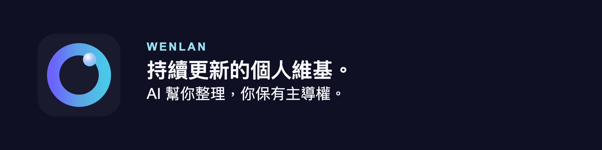
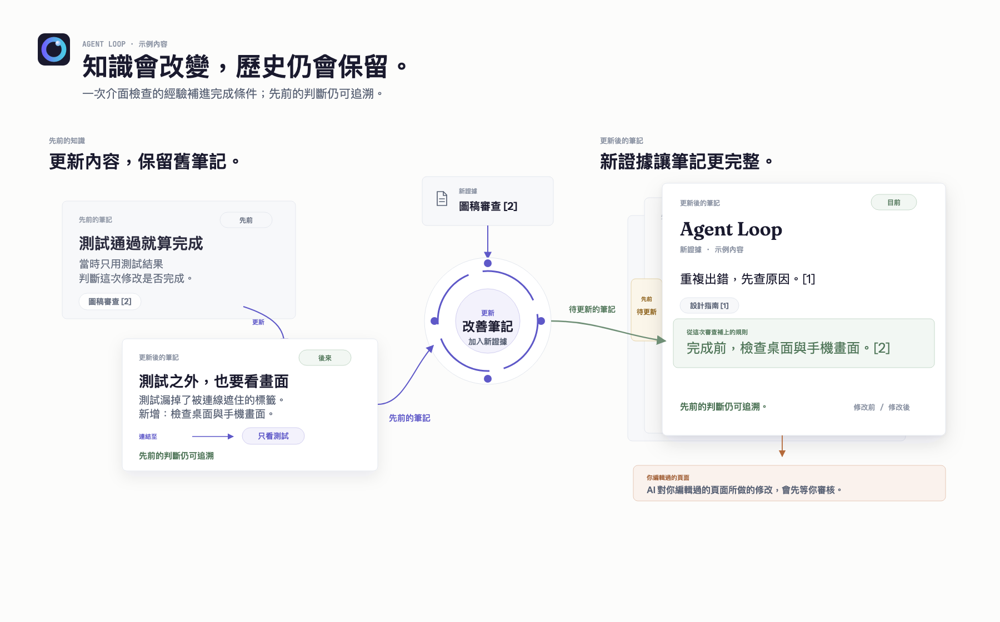

<!-- README_SYNC: source=README.md sha256=dd54d0971e48eacf7cc1f676497781b2898fdd15b9f4819928889926cfb879c4 -->

  <picture>
    <source media="(max-width: 600px)" srcset="./docs/assets/readme-banner-zh-Hant-mobile.png">
    
  </picture>

Wenlan 將筆記、文件與 AI 對話整理成可編輯且連回來源的頁面，讓你和已連接的 AI 工具能延續已有知識。

  <a href="./README.md">English</a> | <a href="./README.zh-Hans.md">简体中文</a> | 繁體中文 | <a href="./README.es-ES.md">Español</a>

  
  
  

  <a href="#start-in-30-seconds">開&#8288;始&#8288;使&#8288;用</a> ·
  <a href="#what-can-i-bring-in">瀏&#8288;覽&#8288;與&#8288;整&#8288;理</a> ·
  <a href="#retrieval">搭&#8288;配&#8288;AI</a> ·
  <a href="#two-lifecycles">持&#8288;續&#8288;更&#8288;新</a> ·
  <a href="#learn-more">文&#8288;件&#8288;與&#8288;社&#8288;群</a> ·
  <a href="https://discord.gg/nmzVTTU3HG">Discord</a>

<!-- Replace the linked walkthrough when the separately produced release video is ready. -->

  
   <a href="https://github.com/user-attachments/assets/e4c934f9-c284-480f-a20f-708d9c91748d">▶ 觀看影片</a>
   封面以實機畫面與示範資料組合而成。

## 開始使用

### 1. 下載並開啟 Wenlan

[下載桌面版](https://github.com/wenlan-app/wenlan/releases/latest)，安裝後開啟：

- **macOS（Apple Silicon）：** 打開 `.dmg`，把 Wenlan 拖進「應用程式」。App 已簽署並通過公證。
- **Windows x64：** 執行 `-setup.exe`，安裝包尚未簽署。若 SmartScreen 警告，先確認檔案來自官方 Releases 頁面，再選「其他資訊」→「仍要執行」。
- **Linux：** 暫無桌面版；請依[AI 設定指南](docs/setup-with-ai.md#install-the-runtime)安裝 runtime。

首次啟動會下載本地搜尋模型，設定完成前請保持連網。[下載與隱私說明](docs/PRIVACY.md#when-wenlan-reaches-the-network)。

### 2. 開啟範例或建立頁面

選擇「開啟筆記」進入 Wenlan，可先看歡迎畫面的範例，或建立自己的頁面。

### 3. 想使用時再連接 AI 工具

需要 AI 使用你保存的知識時，再連接 Claude Code、Codex 或其他支援的用戶端。請依[AI 設定指南](docs/setup-with-ai.md)操作。

> 參考我之前的筆記，幫我接著完成這個任務。

## 瀏覽與整理個人知識

來源是帶入 Wenlan 的原始筆記、文件與對話。記憶保存其中有用的事實與決定；頁面整理相關知識，並連回來源。

可匯入 Markdown、文字檔、可讀取文字的 PDF、資料夾，以及 ChatGPT 或 Claude 匯出的 ZIP。掃描版 PDF 須先擷取文字。

### 探索你的個人知識圖譜

  
   根據實機示範資料調整布局的示意，保留真實關聯。

瀏覽頁面與彼此關聯的概念，點開引用即可查看原始來源。

Obsidian 儲存庫可接為唯讀來源。Wenlan 不會修改或同步回去；需要時再手動重新整理。

## 用 AI 延續已有知識

連接 Claude Code 或 Codex，讓下一個任務能運用你已有的知識。Wenlan 會依關鍵字、相近語意與知識圖譜中的關聯找出內容。

  
   概念示意：虛構專案與對話，非實測比較。

[搜尋方式](docs/technical-foundations.md#retrieval-pipeline)。

實驗中的網頁存取功能可讓支援的用戶端搜尋整個資料庫或指定空間，但執行 Wenlan 的電腦必須保持連線。查詢與結果會經過中繼服務，詳見[隱私界限](docs/PRIVACY.md#pre-release-standalone-wenlan-relay-connector)。

## 持續更新知識並保留歷史

來源會持續變動。你可以請 AI 更新頁面；也可設定[模型](docs/setup-and-data.zh-Hant.md#models)，選用背景整理與自動更新。

  <picture>
    <source media="(max-width: 900px)" srcset="./docs/assets/wenlan-lifecycle-zh-Hant-mobile.png">
    
  </picture>

檔案與資料夾來源會追蹤變更。自動更新若引用不足，就會拒絕草稿。你編輯過的頁面會先提出修訂供你審核；直接改檔與強制重建遵循不同規則。

[更新與審核](docs/knowledge-guide.zh-Hant.md#updates-and-history) · [Doctor 與問題回報](https://wenlan.app/docs/diagnostics-and-issue-reports)。

## 簡單工作流程

找出已有知識 → 保存有用決定 → 整理成頁面 → 下次接著使用。安裝 Wenlan 插件即可使用 `/recall`、`/capture`、`/distill`、`/handoff`（[指令說明](plugin/skills/README.md)）。

### 資料與隱私

頁面與工作筆記是 Markdown 檔案；記憶與圖譜資料保存在本地資料庫。雲端 AI 用戶端可能會把找回的知識傳給其服務商，雲端模型也會收到它處理所需的內容。本地儲存不代表這些互動都留在本機。使用統計預設關閉。

[檔案位置、備份與移除](docs/setup-and-data.zh-Hant.md#backup-and-removal) · [連網與隱私詳情](docs/PRIVACY.md#when-wenlan-reaches-the-network)。

## 評估

這些結果用來檢查搜尋能否找回相關知識，不代表 AI 回答的品質。

搜尋指標

<!-- EVAL_SNAPSHOT_START -->
| Benchmark | Recall@5 | MRR | NDCG@10 |
|---|---:|---:|---:|
| LME_Oracle (500 Q) | 93.6% | 0.857 | 0.883 |
| LME_S (deep, 90 Q) | 87.7% | 0.815 | 0.822 |
<!-- EVAL_SNAPSHOT_END -->

[評估方法與基準詳情](docs/eval/README.md)。

## 進一步了解

從安裝與連接開始，再查閱各項功能的詳細指南：

- [開始使用與安裝](docs/setup-and-data.zh-Hant.md#installation)
- [連接 AI 工具](docs/setup-with-ai.md)
- [來源與匯入](docs/knowledge-guide.zh-Hant.md#sources-and-pages) · [本地檔案、備份與離線使用](docs/setup-and-data.zh-Hant.md)
- [隱私](docs/PRIVACY.md)
- [完整文件索引](docs/README.md)

## 貢獻

歡迎加入 [Discord 社群](https://discord.gg/nmzVTTU3HG)。請在 [GitHub issues](https://github.com/wenlan-app/wenlan/issues) 回報問題或提出功能建議；Issue 是公開的，分享前請遮蔽密鑰與個人資料。程式碼與文件貢獻請見[貢獻指南](.github/CONTRIBUTING.md)、[安全性回報](.github/SECURITY.md)與[行為準則](.github/CODE_OF_CONDUCT.md)。

## 程式碼簽章政策

請見[各平台簽章與公證說明](docs/code-signing.md)。

## 授權

本地 runtime、CLI、MCP server、shared types 與 plugins 採用 [Apache-2.0](LICENSE)。桌面 app 與其前端採用 [AGPL-3.0-only](app/LICENSE)；若將修改版作為網路服務運行，須向使用者提供其原始碼。

## 源流與同類專案

Wenlan 名稱來自文瀾閣，產品方向承接 LLM-wiki 與 agent-memory 脈絡：[Karpathy 的 LLM-wiki note](https://gist.github.com/karpathy/442a6bf555914893e9891c11519de94f)、[Rohitg00 的提案](https://gist.github.com/rohitg00/2067ab416f7bbe447c1977edaaa681e2) 與 [nashsu/llm_wiki](https://github.com/nashsu/llm_wiki)。
