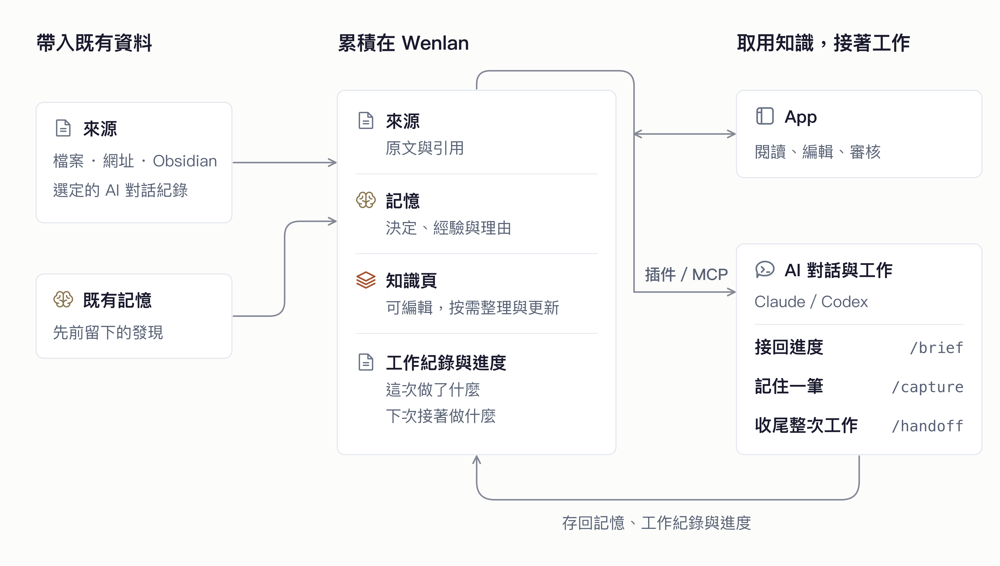

<!-- README_SYNC: source=README.md sha256=3dc9b730a0ba7b43d7070c3b8460e21b538eaa4a2d699eb2d9eeb7620d1ec056 -->

  <picture>
    <source media="(max-width: 600px)" srcset="./docs/assets/readme-banner-zh-Hant-mobile.png">
    
  </picture>

  文瀾將散落的筆記、文件與對話，整理成持續更新、來源可查的知識庫， 
  讓你和 Claude、Codex 等 AI 工具用上先前累積的知識，不必一再交代過去的決定。

  <a href="./README.md">English</a> | <a href="./README.zh-Hans.md">简体中文</a> | 繁體中文 | <a href="./README.es-ES.md">Español</a>

  
  
  

  <a href="#start-in-30-seconds">開&#8288;始&#8288;使&#8288;用</a> ·
  <a href="#what-can-i-bring-in">功&#8288;能</a> ·
  <a href="#learn-more">文&#8288;件</a> ·
  <a href="https://discord.gg/nmzVTTU3HG">Discord</a>

<!-- R113 walkthrough: 1080p GitHub delivery; original masters retained. -->

  
   <a href="https://github.com/user-attachments/assets/6f354266-9400-44a8-8c69-91223a2b7c13">▶ 觀看影片</a>

實機畫面與示範資料的合成圖；圖譜為示意，非 App 原生三欄版面。

## 開始使用

### 1. 下載並開啟 Wenlan

[下載桌面版](https://github.com/wenlan-app/wenlan/releases/latest)，安裝後開啟：

- **macOS（Apple Silicon）：** 打開 `.dmg`，把 Wenlan 拖進「應用程式」。App 已簽署並通過公證。
- **Windows x64：** 執行 `-setup.exe`，安裝包尚未簽署。若 SmartScreen 警告，先確認檔案來自官方 Releases 頁面，再選「其他資訊」→「仍要執行」。
- **Linux：** 暫無桌面版；請依[AI 設定指南](docs/setup-with-ai.md#install-the-runtime)安裝 runtime。

首次啟動會下載本地搜尋模型，設定完成前請保持連網。[下載與隱私說明](docs/PRIVACY.md#when-wenlan-reaches-the-network)。

也可[不安裝桌面 App](docs/setup-and-data.zh-Hant.md#installation)，透過 AI 或 CLI 使用同一個本地知識庫。

### 2. 開啟範例或建立頁面

選擇「開啟筆記」進入 Wenlan，可先看歡迎畫面的範例，或建立自己的頁面。

### 3. 想使用時再連接 AI 工具

| AI 工具 | 連接方式 | 設定入口 |
|---|---|---|
| Claude Code | 插件 | [Claude Code 指南](docs/setup-with-ai.md#claude-code) |
| Codex | 插件 | [Codex 指南](docs/setup-with-ai.md#codex) |
| Cursor、Claude Desktop、VS Code、Gemini CLI | MCP | [MCP 指南](docs/setup-with-ai.md#mcp-only-setup-and-other-clients) |

安裝插件後，開啟新的 AI 對話並執行 `/setup`。連接 AI 不必另裝本地語言模型。

接著試著找回剛開啟或保存的頁面：

> 找回 Wenlan 裡的「［標題］」筆記，附上引用。

**首次使用成功的判準：** AI 找回那份筆記，且你能開啟引用核對內容。

## 日常使用

你可以單獨使用 App，也可以搭配 AI 工作。把值得留下的知識與進度存回 Wenlan，下次接著用。

  

簡化流程示意；插件指令與頁面整理均按需使用，沒有固定順序。

- **從你的資料開始。** 匯入文件與選定的對話作為來源，或在 App 撰寫頁面。你也能編輯內容、查回引用來源、審核修訂，不必連接 AI。
- **運用知識、撰寫新頁面。** 請 AI 用 `/recall` 找回相關來源與記憶，接著完成任務；也能撰寫帶引用的新頁面，存回 Wenlan。
- **留下你的新發現。** 在 App 中，或請 AI 使用 `/capture`，保存決定或心得，以及其理由與來源。
- **告一段落，下次接續。** 用 `/handoff` 保存進度與下一步，同時留下值得保留的記憶與工作紀錄。下次用 `/brief` 讀取專案摘要，接回這些脈絡。

**按需整理累積的記憶：** `/distill` 將相關記憶整理或更新為帶引用的頁面，不是撰寫新頁面的必要步驟。[插件指令](plugin/skills/README.md)。

## 把散落的資料整理成知識

**來源**保留你讀過的資料；**記憶**留下你的發現與判斷理由。將兩者整理成**帶有引用的 Markdown 頁面**，讓你閱讀、編輯，用 `[[wikilinks]]` 連結相關內容，也能沿引用查回原始資料。

- **檔案與對話匯入**：匯入 Markdown、文字檔、文字型 PDF、資料夾，以及 ChatGPT 或 Claude 匯出的 ZIP，保留來源參照。掃描版 PDF 須先擷取文字再匯入。對話匯入保留當時紀錄；已登錄的檔案來源可重新整理為最新內容。
- **Obsidian 唯讀連接**：讀取既有儲存庫並按需重新整理，不修改原始檔案，也不將變更同步回去。
- **原子記憶**：單獨找回一筆發現，不必載入整段對話或整份頁面。
- **知識圖譜**：透過不同類型的實體、關係與知識群集（communities），發現相關主題；設定整理模型後，將重複提及連到同一實體。

  

保留實機節點與連線；文字經翻譯，區域名稱與範圍為示意。

## 讓 AI 接續已有知識

在不同 AI 工具間共用同一個知識庫。**插件**引導 AI 何時取回先前脈絡、保存新決定；**僅連接 MCP** 則讓 AI 可按需或依你的要求呼叫這些工具。

- **[本地混合檢索（Hybrid Retrieval）](docs/technical-foundations.md#retrieval-pipeline)**：用 SQLite FTS5 找出相同詞句、BGE 向量找出相近語意，再以加權 RRF 合併排名；基礎搜尋不需 API key。
- **圖譜輔助排序**：有可用的實體連結時，提高相關記憶的排名，也可選用 cross-encoder reranking 精排結果。
- **Spaces 範圍檢索**：選定 Space，將回傳的知識限制在相關專案或個人資料集合內。

  

虛構案例，非產品測試；文瀾補充脈絡，與 Claude 原生記憶搭配使用。

實驗中的網頁存取功能可讓支援的用戶端搜尋整個資料庫或指定空間，但執行 Wenlan 的電腦必須保持連線。查詢與結果會經過中繼服務，詳見[隱私界限](docs/PRIVACY.md#pre-release-standalone-wenlan-relay-connector)。

## 更新知識，保留歷史

**依引用關係更新。** Wenlan 中的來源或記憶變更、移除時，引用它的頁面會被標記為待更新。啟用背景 AI 並有可用模型後，符合條件的頁面會依最新資料重新整理；引用不足的草稿不會採用。

- **Steep 背景整理**：為已保存的記憶補上類型、結構化資訊、搜尋線索與圖譜連結；也可選擇將記憶與來源合成為帶有引用的頁面。
- **[修訂審核與歷史](docs/knowledge-guide.zh-Hant.md#updates-and-history)**：比較頁面版本、追溯記憶的取代關係；自動更新時，符合條件的 AI 維護頁面直接更新，你編輯過的頁面則提出修訂供審核。
- **維基匯出**：將符合條件的頁面匯出為 Open Knowledge Format（OKF）維基。
- **[選配的背景模型](docs/setup-and-data.zh-Hant.md#models)**：用裝置端 Qwen（llama.cpp）、Ollama 或 LM Studio 等 OpenAI 相容本地服務，或已設定的雲端供應商啟用整理、頁面合成與自動更新。

  

實機畫面搭配示範資料；連線與標註為示意。

## 系統架構

**共用本地知識庫。** App、CLI 與 AI 工具透過 Wenlan 本地服務讀寫。頁面以 Markdown 保存；記憶、關係與搜尋索引由本地 libSQL 管理。

  

架構示意。[檢索、引用與模型](docs/technical-foundations.md)。

## 資料與隱私

雲端 AI 用戶端可能會把找回的知識傳給其服務商，雲端模型也會收到它處理所需的內容。本地儲存不代表這些互動都留在本機。使用統計預設關閉。

[檔案位置、備份與移除](docs/setup-and-data.zh-Hant.md#backup-and-removal) · [連網與隱私詳情](docs/PRIVACY.md#when-wenlan-reaches-the-network)。

## 評估

這些 LongMemEval（LME）測量結果評估的是已存知識的檢索，不是 AI 回答品質。Recall@5 表示相關資料出現在前五筆結果中的比例。

<!-- EVAL_SNAPSHOT_START -->
| Benchmark | Recall@5 | MRR | NDCG@10 |
|---|---:|---:|---:|
| LME_Oracle (500 Q) | 93.6% | 0.857 | 0.883 |
| LME_S (deep, 90 Q) | 87.7% | 0.815 | 0.822 |
<!-- EVAL_SNAPSHOT_END -->

[評估方法與基準詳情](docs/eval/README.md)。

## 進一步了解

- [開始使用與安裝](docs/setup-and-data.zh-Hant.md#installation)
- [連接 AI 工具](docs/setup-with-ai.md)
- [來源與匯入](docs/knowledge-guide.zh-Hant.md#sources-and-pages) · [本地檔案、備份與離線使用](docs/setup-and-data.zh-Hant.md)
- [隱私](docs/PRIVACY.md)
- [Doctor 與問題回報](https://wenlan.app/docs/diagnostics-and-issue-reports)
- [完整文件索引](docs/README.md)

## 貢獻

歡迎加入 [Discord 社群](https://discord.gg/nmzVTTU3HG)。請在 [GitHub issues](https://github.com/wenlan-app/wenlan/issues) 回報問題或提出功能建議；Issue 是公開的，分享前請遮蔽密鑰與個人資料。程式碼與文件貢獻請見[貢獻指南](.github/CONTRIBUTING.md)、[安全性回報](.github/SECURITY.md)與[行為準則](.github/CODE_OF_CONDUCT.md)。

## 程式碼簽章政策

請見[各平台簽章與公證說明](docs/code-signing.md)。

## 授權

本地 runtime、CLI、MCP server、shared types 與 plugins 採用 [Apache-2.0](LICENSE)。桌面 app 與其前端採用 [AGPL-3.0-only](app/LICENSE)；若將修改版作為網路服務運行，須向使用者提供其原始碼。

## 源流與同類專案

Wenlan 名稱來自文瀾閣，產品方向承接 LLM-wiki 與 agent-memory 脈絡：[Karpathy 的 LLM-wiki note](https://gist.github.com/karpathy/442a6bf555914893e9891c11519de94f)、[Rohitg00 的提案](https://gist.github.com/rohitg00/2067ab416f7bbe447c1977edaaa681e2) 與 [nashsu/llm_wiki](https://github.com/nashsu/llm_wiki)。
